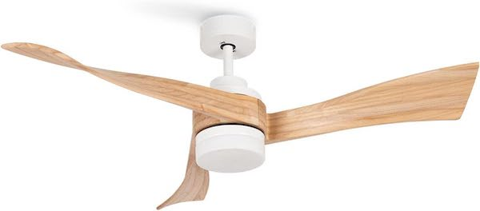
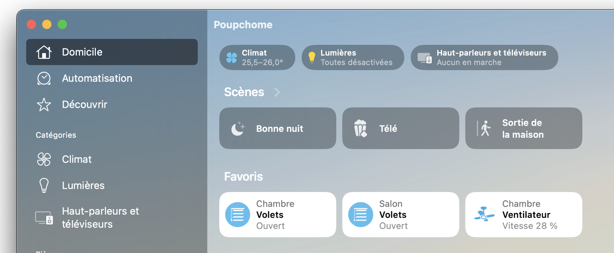
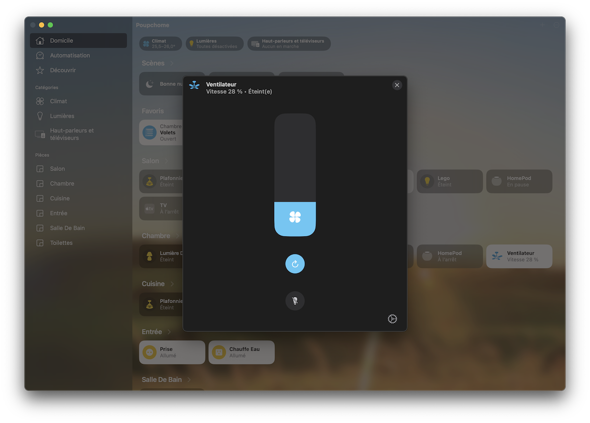

# CREATE Ceiling Fan

Control your CREATE Ceiling Fan from HomeKit, locally (no cloud).
- Turn fan on/off
- Adjust fan speed (6 steps, shown as a slider in the Home app)
- Reverse rotation direction (summer/winter mode)
- Turn light on/off
- Momentary toggle and speed up/down tiles (automation and remote friendly)




*The fan and light controls in the Home app. The optional `Toggle` and `Speed Up` / `Speed Down`
tiles described below are not shown.*

## Installation

Go to the Homebridge UI, Plugins screen and search for `homebridge-create-ceiling-fan`. Install the plugin and use the form to configure it.

## Configuration

Each fan needs:

| Field  | Description |
|--------|-------------|
| `name` | Name shown in the Home app. |
| `ip`   | Static IP address of the fan. Assign a fixed IP to each fan in your router (DHCP reservation). |
| `id`   | Tuya device ID, unique per fan. |
| `key`  | Tuya local key. It changes every time the fan is re-paired in the Tuya / Smart Life app. |

To get your fan's `id` and `key`, follow [Getting your keys](https://github.com/jasonacox/tinytuya/tree/master#setup-wizard---getting-local-keys).

```json
{
  "platform": "HomebridgeCreateCeilingFan",
  "devices": [
    { "id": "…", "key": "…", "name": "Ceiling Fan", "ip": "192.168.1.100" }
  ]
}
```

### Optional settings

| Field          | Default | Description |
|----------------|---------|-------------|
| `light`        | `true`  | Exposes a Lightbulb tile for the fan's light. Set to `false` for fan models without a light (this also hides the light toggle tile). |
| `toggles`      | `true`  | Exposes two momentary `Toggle` tiles (see below). |
| `speedButtons` | `true`  | Exposes `Speed Up` / `Speed Down` tiles (see below). |
| `version`      | `"3.4"` | Tuya local protocol version: `"3.1"`, `"3.2"`, `"3.3"`, `"3.4"` or `"3.5"`. Most CREATE fans (2023 and later) use `3.4`; older units may need `3.3`. |

```json
{
  "platform": "HomebridgeCreateCeilingFan",
  "devices": [
    {
      "id": "…", "key": "…", "name": "Ceiling Fan", "ip": "192.168.1.100",
      "light": false, "toggles": false, "speedButtons": true, "version": "3.3"
    }
  ]
}
```

#### Toggle tiles

Two extra momentary tiles named `Toggle`, rendered with the Apple Home fan and light bulb icons. Tap
the tile in the Home app (or trigger it from a scene, an automation or a HomeKit remote) and the plugin
flips the fan or light state, then resets the tile back to OFF. Perfect for a single-press "toggle"
button on a remote.

#### Speed Up / Speed Down tiles

Two extra momentary fan tiles. Each tap moves the speed one step (1 to 6). `Speed Up` turns the fan
on at step 1 when it is off; `Speed Down` turns it off when it is already at step 1.

## Troubleshooting

- **`ECONNRESET` right after `Connected!`**: the protocol `version` is probably wrong. Try `3.3`
  (or `3.4` if you had set something else).
- **`Wrong local key` in the logs**: the `key` is wrong or out of date. Re-pairing the fan in the
  Tuya / Smart Life app generates a new key: fetch it again with the tinytuya wizard.
- **`connect failed` in a loop**: check that the `ip` is right and still assigned to the fan (DHCP
  reservation), and that Homebridge can reach that network.
- **Frequent disconnects / reconnects**: a Tuya fan accepts a single local connection at a time. Make
  sure no other local client controls it (a second Homebridge instance, Home Assistant, tinytuya
  scripts…).
- **A fan is skipped at startup**: the logs say why (a missing `id`, `key` or `ip`, or the same
  `id` used for two fans).

## Development

```bash
npm install
npm test        # build, type-check the tests, run them with node:test
npm run lint
```

`npm run watch` rebuilds on change and runs a local Homebridge instance with the config in
`test/hbConfig` (git-ignored). Create it from the example and fill in your fan:

```bash
cp -r test/hbConfig.example test/hbConfig
```

## Thanks

- [tuyapi](https://github.com/codetheweb/tuyapi)
- @marsuboss
